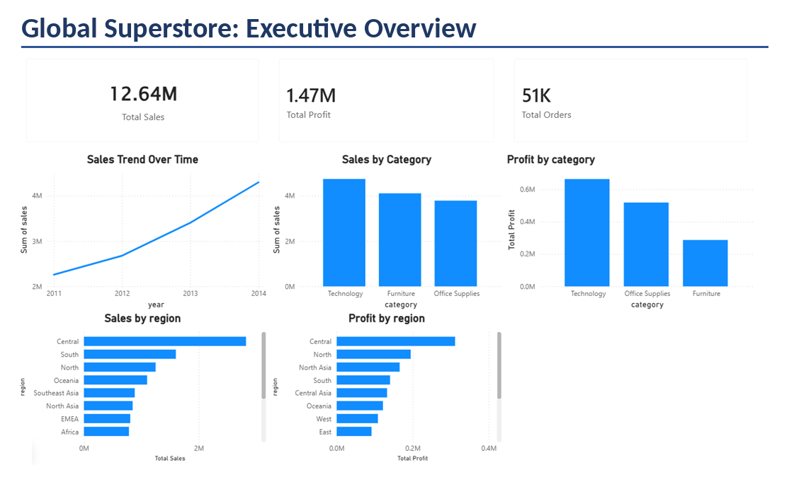
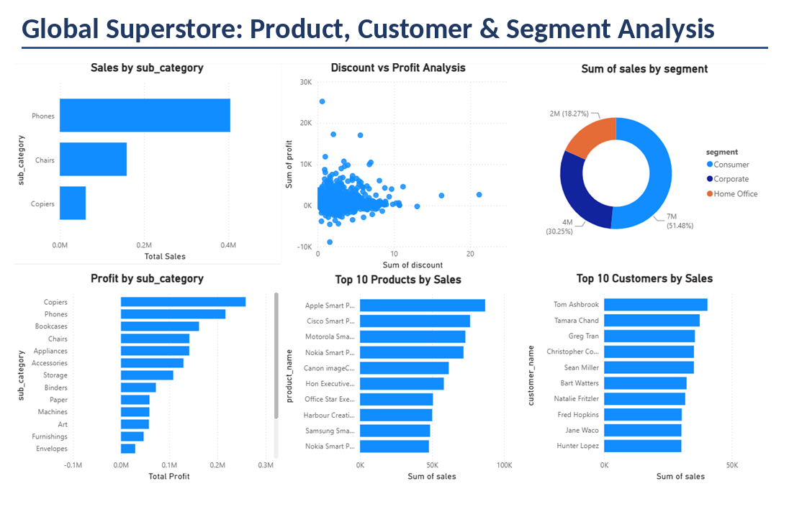

README.md

# Global Superstore Sales Analysis

## Project Overview

This project analyzes the Global Superstore dataset using PostgreSQL and Power BI to identify sales trends, profitability drivers, customer behavior, product performance, and regional performance.

## Tools Used

* PostgreSQL
* SQL
* Power BI

## Dataset

* Global Superstore Dataset
* 51,290 transaction records

## Business Questions Answered

* What are the total sales, profit, and orders?
* Which categories generate the highest sales and profit?
* Which regions perform best?
* Who are the most valuable customers?
* Which products generate the highest revenue and profit?
* How have sales changed over time?
* How do discounts affect profitability?

## Key Findings

* Technology was the highest-performing category in both sales and profit.
* The Central region generated the highest sales and profit.
* Sales increased consistently from 2011 to 2014.
* High discount levels were associated with lower profitability.
* Top-spending customers were not always the most profitable customers.
* Technology products dominated both sales and profit rankings.

## Project Files

### Images

* Executive_Overview.png
* Product_Analysis.png

### Power BI

* Superstore_Sales_Analysis.pbix

### SQL

* analysis_queries.sql

## Skills Demonstrated

* SQL Querying
* Data Cleaning
* Data Aggregation
* Business Analysis
* KPI Reporting
* Dashboard Development
* Data Visualization
* Insight Generation

## Dashboard

